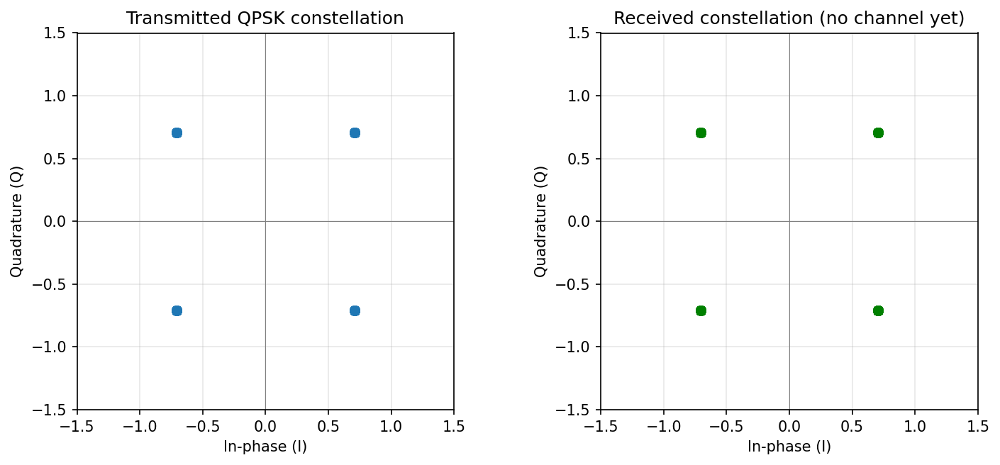
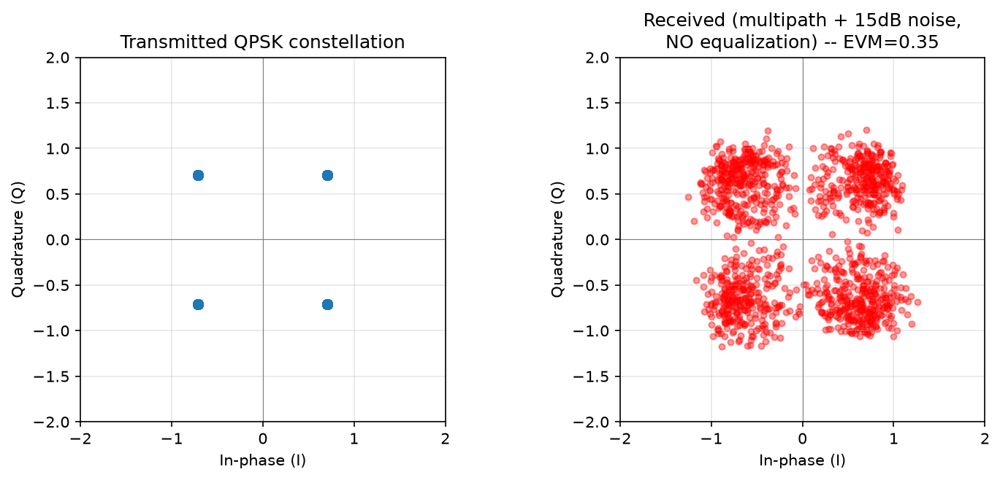
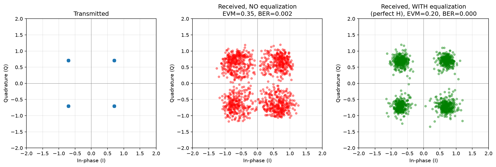
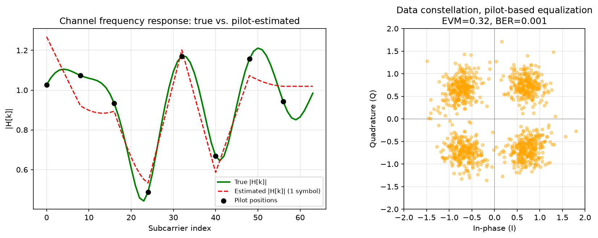
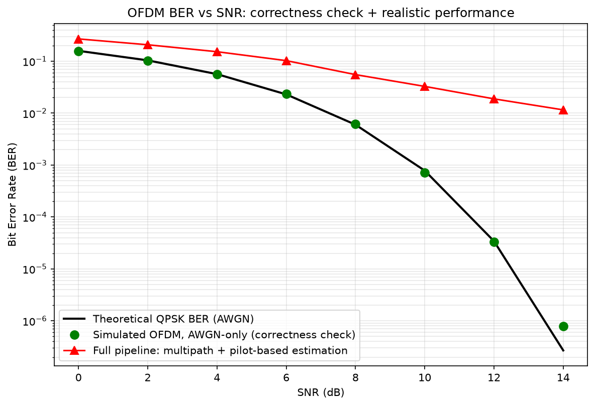

# OFDM From Scratch

A complete OFDM transmit → channel → receive chain, built from scratch
in Python (no built-in "OFDM" library functions) — QPSK modulation,
IFFT/FFT-based OFDM signal generation, a multipath + noise channel,
equalization, realistic pilot-based channel estimation, and a final
BER-vs-SNR validation against theory.

OFDM is the physical-layer backbone of Wi-Fi, LTE, and 5G. This project
builds and verifies every stage of that chain independently, the same
way I approached debugging and extending my [URLLC CQI prediction
project](https://github.com/inam086771-source/urllc-cqi-prediction-2026) —
each stage has its own correctness check before moving to the next.

## Why this project

My background is in wireless protocol testing and channel-prediction
ML (see the URLLC project above). This project fills in the classical
DSP/PHY-layer side: understanding and implementing, from first
principles, what actually happens to bits between a transmitter and a
receiver in a modern wireless system.

## The 6 stages

### Stage 1 & 2 — Modulation and OFDM signal generation
Bits are Gray-coded onto a QPSK constellation, arranged across 64
subcarriers, converted to a time-domain waveform via IFFT, and given a
cyclic prefix (which is what makes OFDM resistant to multipath delay
spread, and is what lets the simple per-subcarrier equalization in
Stage 4 work at all).

**Verification**: with no channel yet, demodulating the signal
immediately after modulating it recovers the exact original bits —
0 bit errors, symbol reconstruction error at floating-point precision
(~1e-16).



### Stage 3 — Channel: multipath + noise
The signal is passed through a 5-tap multipath channel (Rician-flavored,
using the same 7 dB K-factor as the URLLC project — one dominant
line-of-sight tap plus weaker reflected taps) and AWGN noise at 15 dB
SNR.

**Result**: the clean QPSK constellation points become "clouds" —
scattered and shifted, since each subcarrier is multiplied by a
different, unknown complex channel gain.



### Stage 4 — Equalization (perfect channel knowledge)
Because of the cyclic prefix, the channel's effect on each subcarrier
reduces to a single complex multiplication (not full convolution) — so
undoing it is just dividing by the channel's frequency response, H[k].
This stage uses perfect knowledge of H[k] to verify the equalization
math itself is correct, before Stage 5 makes it realistic.

**Result**: Bit Error Rate drops from 0.16% (no equalization) to 0.00%.



### Stage 5 — Realistic channel estimation via pilots
Real receivers don't know the channel in advance. This stage replaces
the "cheat" with pilot symbols — known reference values sent on every
8th subcarrier — from which H[k] is estimated at pilot positions and
linearly interpolated across the data subcarriers in between.

**Result**: BER rises slightly versus perfect knowledge (0.09% vs
0.00%), which is the expected, realistic cost of not knowing the
channel exactly — not a bug.



### Stage 6 — BER vs SNR, validated against theory
The full pipeline is swept across SNR from 0–14 dB and compared
against two references: the closed-form theoretical QPSK BER formula
(AWGN-only case), and the realistic multipath + pilot-estimation case.

**A real bug was found and fixed here**: the first version of the
theoretical formula was missing a factor of 2 (an Es-vs-Eb scaling
error — for QPSK, symbol energy Es = 2 × bit energy Eb, which changes
the formula from `0.5·erfc(√SNR)` to the correct `0.5·erfc(√(SNR/2))`).
The simulated AWGN-only curve sitting clearly above the (wrong)
theoretical line was the signal that something was off; comparing the
two, rather than assuming the mismatch was just noise, led to finding
and fixing it — the same debugging discipline used on the URLLC
project's Rician channel fix.

With the corrected formula, the simulated AWGN-only curve matches
theory closely across the full SNR range, confirming the OFDM chain
(Stages 1–2) is implemented correctly. The full pipeline (red) sits
above it, showing the real cost of a fading channel and imperfect
channel knowledge.



## Repository contents

- `stage1_2_ofdm_modulation.py` — QPSK modulation, OFDM signal
  generation (IFFT/FFT + cyclic prefix)
- `stage3_channel.py` — multipath channel + AWGN noise
- `stage4_equalization.py` — zero-forcing equalization (perfect channel
  knowledge)
- `stage5_pilot_estimation.py` — realistic pilot-based channel
  estimation
- `stage6_ber_vs_snr.py` — SNR sweep, BER curves, theoretical
  validation
- `*.png` — output plots from each stage

## Running it

```bash
pip install numpy scipy matplotlib
python stage1_2_ofdm_modulation.py   # Stage 1+2
python stage3_channel.py              # Stage 3
python stage4_equalization.py         # Stage 4
python stage5_pilot_estimation.py     # Stage 5
python stage6_ber_vs_snr.py           # Stage 6 (takes ~15-20s)
```

Each stage's file imports from the previous ones, so keep them all in
the same folder. No GPU needed — this is pure signal-processing, not
machine learning.
